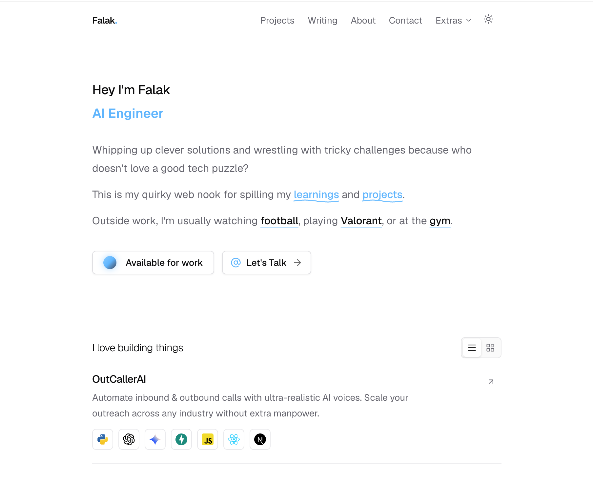

# Falak Gala — Personal Portfolio & Engineering Blog

[](https://falakgala.dev)
[](https://nextjs.org)
[](https://tailwindcss.com)
[](https://workers.cloudflare.com)

Minimalist editorial developer portfolio, project showcase, and technical writing platform built with **Next.js 16 App Router**, **React 19**, **Tailwind CSS v4**, **Motion**, and **Fumadocs MDX**, deployed globally on **Cloudflare Workers** via OpenNext.

<p align="center">
  <a href="https://falakgala.dev">
    
  </a>
</p>

## Highlights & UI/UX Engineering

- **Editorial Minimalism**: Narrow single-column reading canvas (`Geist Sans` & `Geist Mono`), neutral surfaces, restrained `#5CBEFF` accent, and crisp micro-interactions with reduced-motion support.
- **Dual List / Grid Showcase**: Persistent list and grid view toggles across Projects and Bookmarks with intentional hover/focus preview cards.
- **Headless MDX Publishing (`Fumadocs MDX`)**: Schema-validated frontmatter, build-time compilation, Shiki dual light/dark code highlighting, responsive table of contents, dynamic per-post Open Graph images, and full-content RSS (`/rss.xml`).
- **SEO & GEO Ready**: Schema.org `@graph` JSON-LD (`Person`, `WebSite`, `ProfilePage`, `BlogPosting`, `SoftwareApplication`), canonical redirects, dynamic `/sitemap.xml`, `/robots.txt`, `/llms.txt`, and `/llms-full.txt`.
- **Edge Infrastructure**: Server-side visitor tracking, contact form rate limiting, and AI response caching backed by **Cloudflare D1** and **R2** incremental cache ([migration docs](docs/cloudflare/upstash-to-d1-migration.md)).
- **Interactive Extras**: `Ctrl+K` AI persona assistant, curated bookmarks board, and live `/stats` telemetry (Tokscale AI token usage + Cloudflare Web Analytics).

## Tech Stack

| Layer | Technology |
| --- | --- |
| Framework | Next.js 16 (App Router, Turbopack), React 19 |
| Styling & Motion | Tailwind CSS v4, Motion, Radix UI, Lucide |
| Content Engine | Fumadocs MDX, Fumadocs Core, Shiki |
| Edge & Storage | Cloudflare Workers (`@opennextjs/cloudflare`), Cloudflare D1, R2 |
| Typography | Geist Sans & Geist Mono |

## Project Structure

```text
src/
├── app/                 # App Router pages, dynamic OG images, sitemap, robots, RSS, llms.txt
├── actions/             # Server actions (D1 visitor tracking, contact email, bookmarks, AI)
├── components/          # UI primitives, animated icons, AI widget, blog & stats views
├── content/blog/        # MDX engineering articles & case studies
└── lib/                 # Metadata helpers, Fumadocs source loader, project/about data, D1 client
```

## Local Development

```bash
pnpm install
pnpm dev
```

Open [http://localhost:3000](http://localhost:3000) to view the site locally.

### Build & Cloudflare Verification

```bash
pnpm build
pnpm run build:cf
```

## License & Attribution

Source code is public for learning and portfolio inspiration. If you draw inspiration from the architecture or design, a link back to [falakgala.dev](https://falakgala.dev) is always appreciated.
